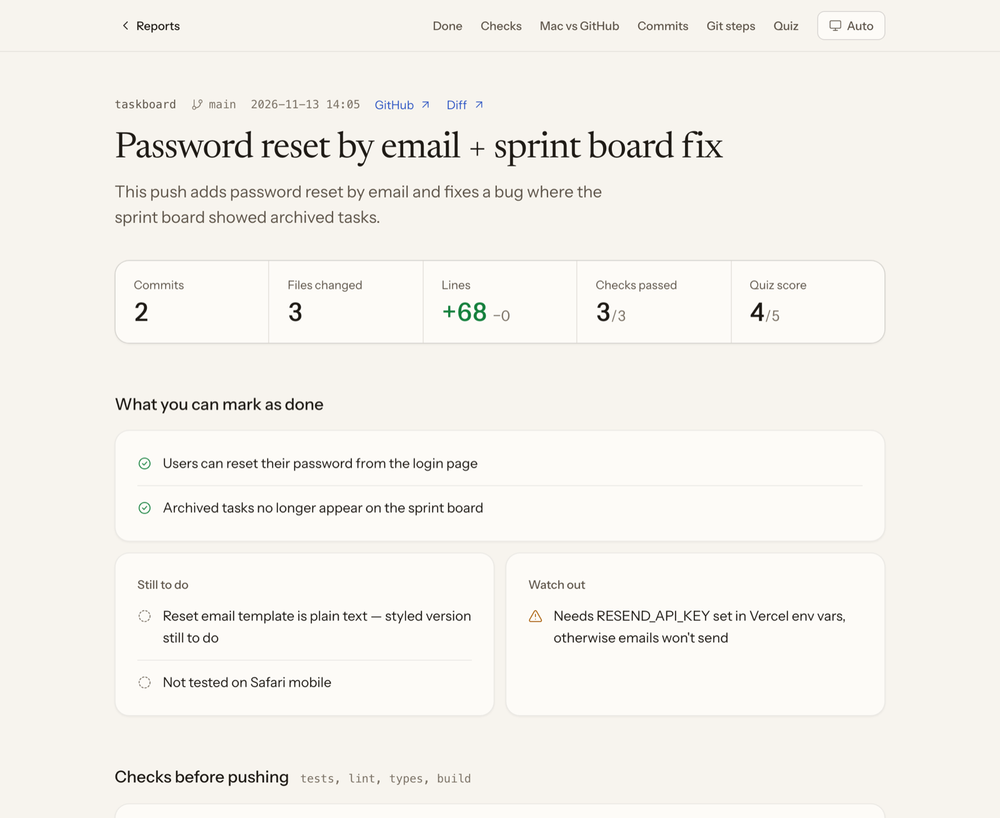
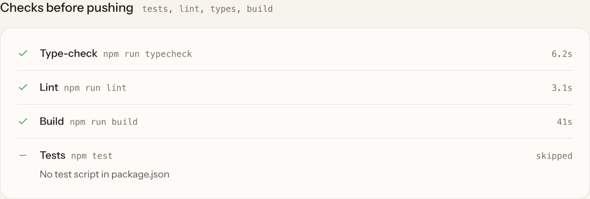
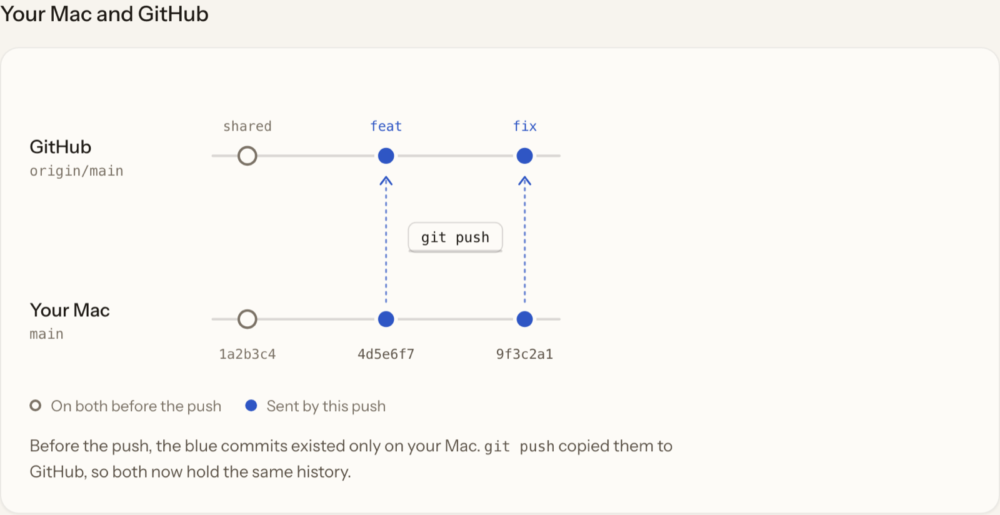
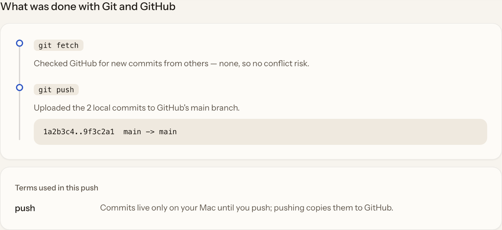
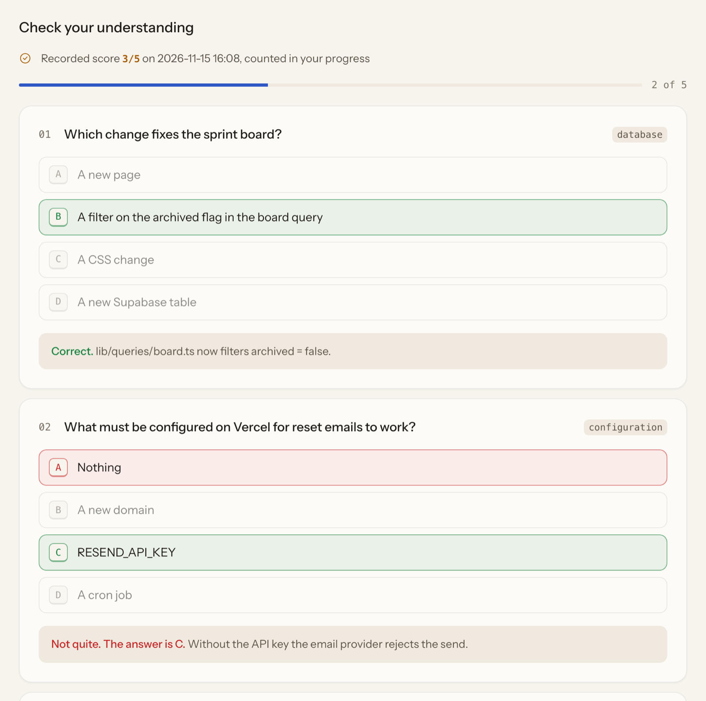

<div align="center">

# git-explained

**Understand every commit and push your AI makes.**

A [Claude Code](https://claude.com/claude-code) skill that explains each git commit and push in plain language,<br>
then builds a local HTML report with a short quiz, so you know what changed in your repo.

[](LICENSE)


<picture>
  <source media="(prefers-color-scheme: dark)" srcset="docs/screenshots/report-top-dark.png">
  
</picture>

</div>

---

## Why

When an AI agent writes most of your code, it's easy to end up with a repo full of commits you never really read. **git-explained** makes Claude stop and explain every one, and asks you a few questions afterwards to check you followed. You get:

- 🗣️ **Plain-language explanations** before anything is committed or pushed
- ✅ **A "what you can mark as done" list** ready for your tracker, standup or client update
- 🧪 **Checks before every push**: typecheck, lint, tests, build
- 📄 **A good-looking HTML report** for every push, saved on your machine
- 🎯 **A short quiz** that adapts to the topics you get wrong
- 🎓 **Git lessons along the way**: each report explains the git operations it used

---

## What you get

### 1. A plan before every commit

Before committing, Claude shows what it's about to save and why:

```
📦 Commit plan
What:   Add password reset by email
Why:    Users who forgot their password had no way back in
Files:  app/reset-password/page.tsx: the form where the user types their email
        app/login/page.tsx: adds the "Forgot password?" link
Effect: Users can reset their password from the login page
```

Then it writes a structured commit message (`type(scope): summary` + *Why* / *What* / *Project status*) and reminds you the commit is **local until you push**.

### 2. Checks before every push

The skill detects the project's checks (npm/pnpm/yarn/bun scripts, pytest, ruff, mypy, cargo, go, swift) and runs them. **If one fails, it stops and asks.**



### 3. "Your Mac vs GitHub" in a diagram

Each report draws which commits were only on your machine and which ones the push sent.



### 4. Every commit explained

The why, what changed, every file touched, and the key lines of code with a short explanation.


### 5. Git and GitHub steps, explained

Every command that ran (`fetch`, `push -u`, `remote set-url`…) with what it actually did, plus a short glossary.



### 6. A quiz to check you understood

5–8 multiple-choice questions on **what** changed, **why**, **where** in the code, the **impact**, and the **git operations**. You get instant feedback on each answer.



### 7. Progress over time

All reports are listed in one index, with your score trend and accuracy per topic. Topics under 70% are marked **focus** and come up more in the next quizzes.


> Reports follow your system's light/dark theme, and there's a toggle in the top-right corner.

---

## Installation

```bash
git clone https://github.com/mbaudran/git-explained.git ~/.claude/skills/git-explained
```

That's it: Claude Code loads skills from `~/.claude/skills/` automatically.
**Requirements:** Python 3 (standard library only) and git. `gh` is optional, used for GitHub URLs.

**Recommended:** add this to `~/.claude/CLAUDE.md` so the skill also applies to commits made inside bigger tasks:

```markdown
## Git commits & pushes
- Every `git commit` and every `git push` → follow the `git-explained` skill.
```

---

## Usage

Talk to Claude Code as usual:

| You say | What happens |
|---|---|
| `commit this` | Commit plan → commit → confirmation |
| `push` | Checks → push plan → push → HTML report opens |
| `commit and push` | One commit per logical change, then one push |
| `/git-explained` | Invoke the skill explicitly |

### Taking the quiz

After each push, Claude asks how you want to take it:

- **In the terminal** (recommended): questions appear as multiple choice, and your score is saved automatically.
- **In the HTML page**: when you finish, the page shows a line like
  `git-explained quiz taskboard/2026-11-15_1608_main.html: B,C,A,A,B`. Paste it into any Claude Code session to save the score.
- **Later.**

### Running the renderer yourself

```bash
# Build a report from JSON (full schema: assets/example.json)
python3 scripts/render_report.py data.json

# Record a quiz attempt
python3 scripts/render_report.py record ~/git-reports/<repo>/<report>.html --picks B,C,A,A,B --source html

# List weak topics (Claude uses this to tailor the next quiz)
python3 scripts/render_report.py weak
```

Every command accepts `--out-dir <path>` to write somewhere other than `~/git-reports`. Handy for trying it out:

```bash
python3 scripts/render_report.py assets/example.json --out-dir /tmp/git-explained-demo
open /tmp/git-explained-demo/index.html
```

---

## Safety rules built in

- Never commits secrets or junk (`.env`, keys, tokens, `node_modules`, build output, `.DS_Store`); it warns you and suggests a `.gitignore` entry instead.
- Never amends, rebases, resets, force-pushes or skips hooks without explaining the risk and asking first.
- Asks before pulling when GitHub has commits you don't have.
- Says plainly when something wasn't tested.

## Privacy

Everything stays on your machine. Reports and scores live in `~/git-reports/`, and nothing is uploaded anywhere. The report pages only load fonts from Google Fonts.

---

## Project layout

```
SKILL.md                  instructions Claude follows (Part A = commit, Part B = push)
scripts/render_report.py  builds reports + index, records quiz attempts, lists weak topics
assets/example.json       full worked example of the report data (fake "taskboard" app)
docs/screenshots/         images used in this README (rendered from the example)
```

## Contributing

Issues and pull requests are welcome, whether it's ideas for new checks, better quiz questions, or report layouts.

## Credits

The report's visual design was guided by [unslop](https://github.com/heydamir/unslop) by Damir Sokolovsky ([@heydamir](https://github.com/heydamir)), CC BY 4.0.

## License

[MIT](LICENSE)
