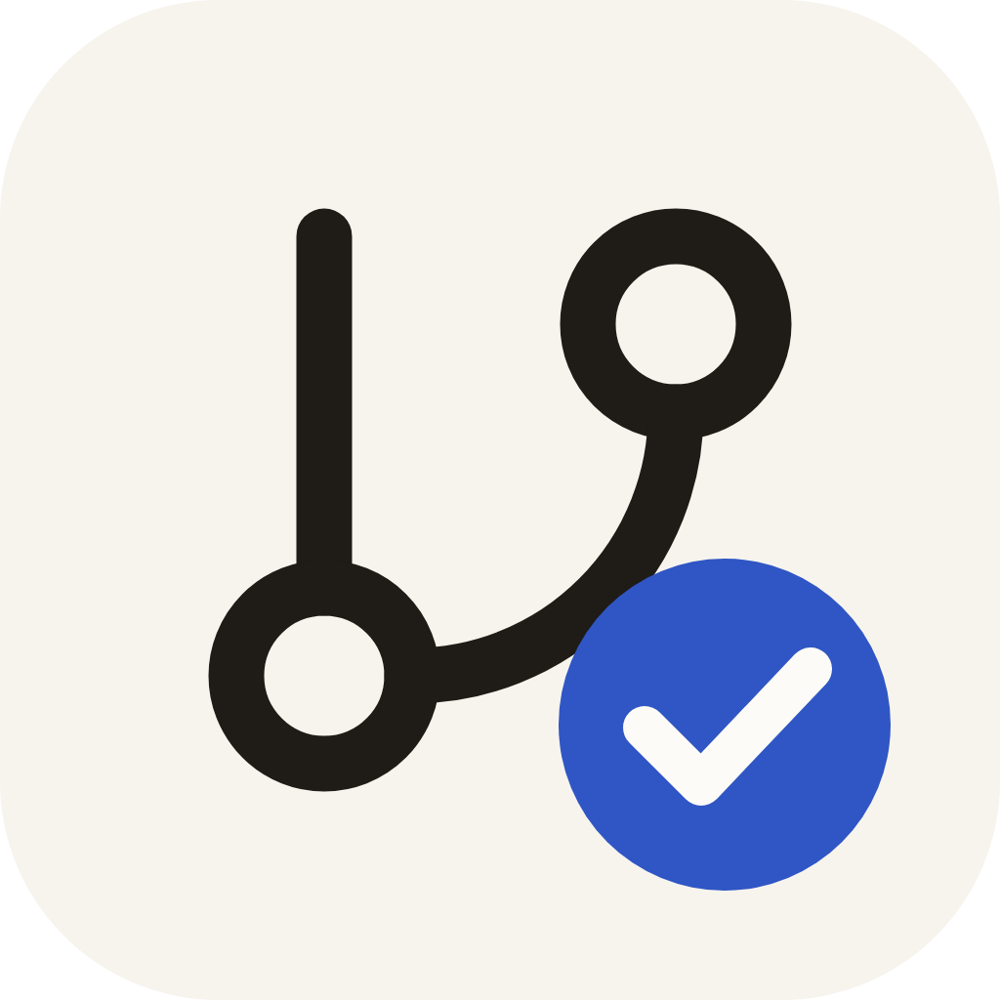
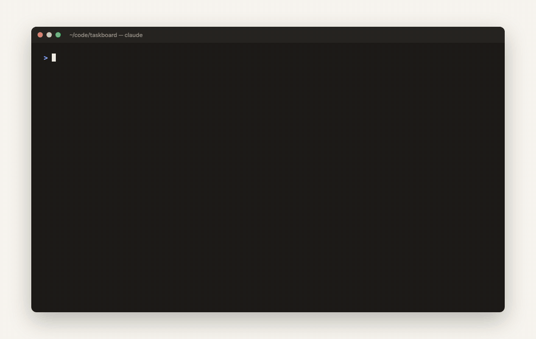
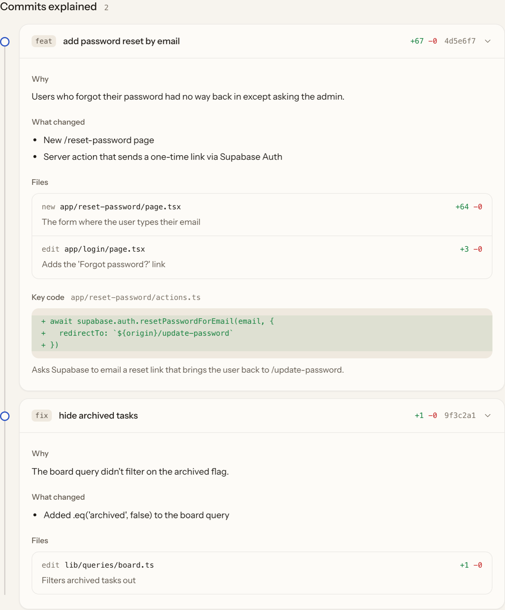
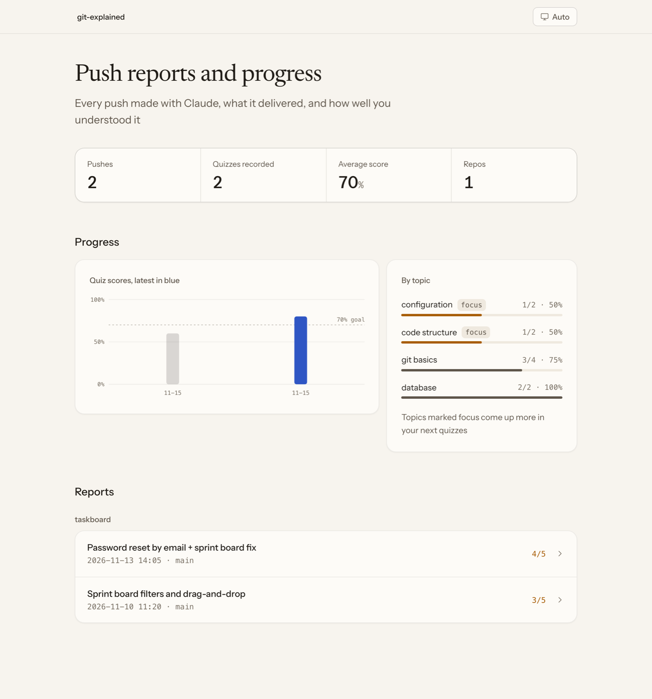
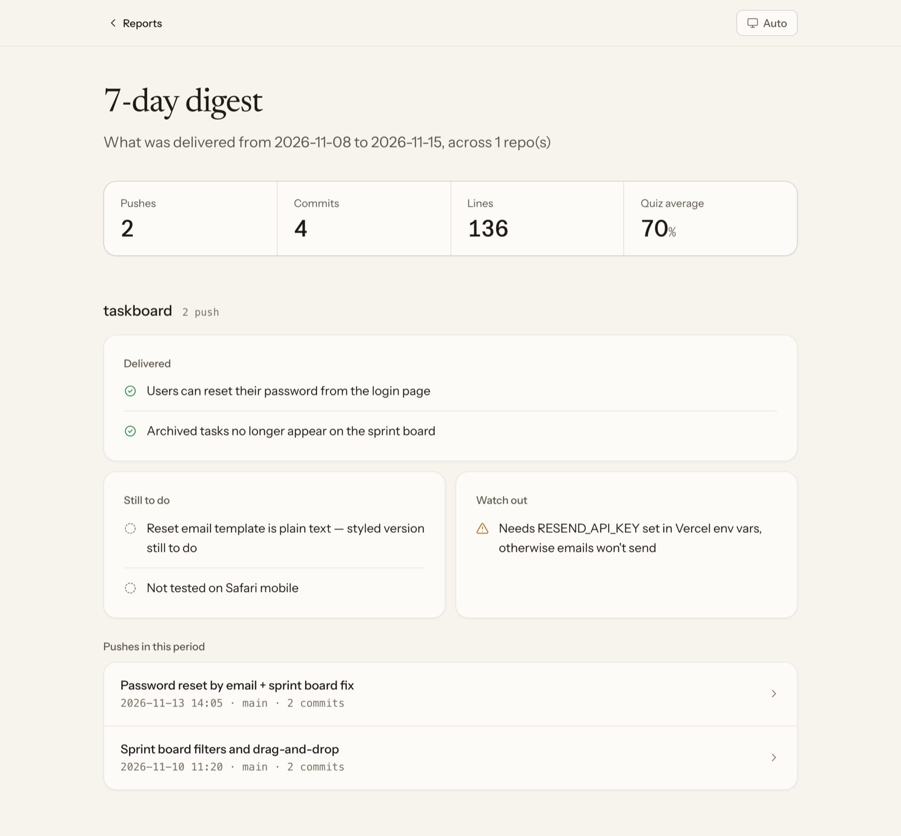
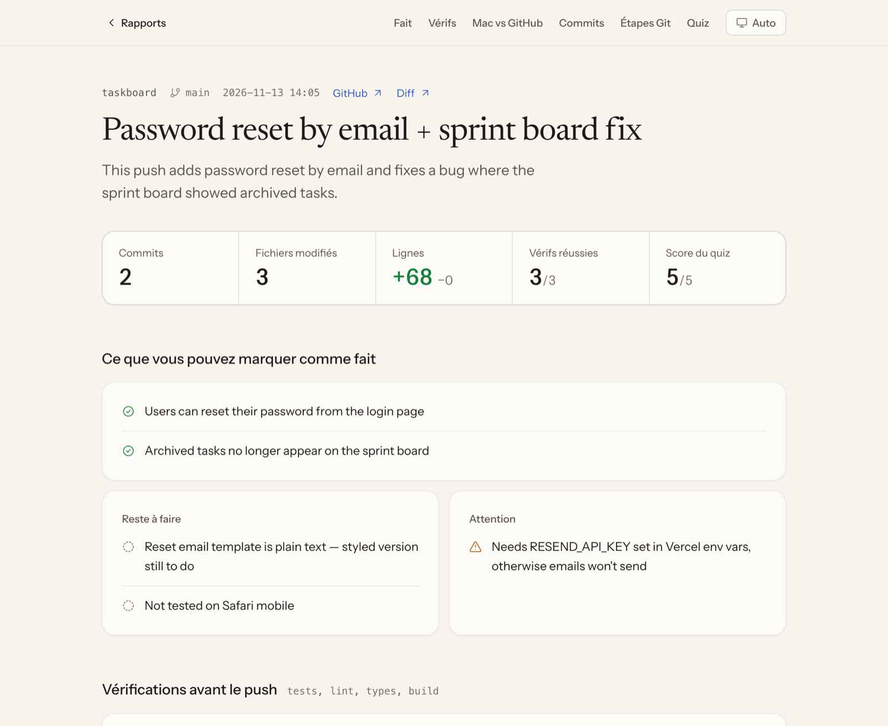

<div align="center">



# git-explained

**Understand every commit and push your AI makes.**

A [Claude Code](https://claude.com/claude-code) plugin that explains each git commit and push in plain language,<br>
then builds a local HTML report with a short quiz, so you know what changed in your repo.

[](https://github.com/mbaudran/git-explained/actions/workflows/tests.yml)
[](LICENSE)


```
/plugin marketplace add mbaudran/git-explained
/plugin install git-explained@git-explained
```



</div>

---

## Why

When an AI agent writes most of your code, it's easy to end up with a repo full of commits you never really read. **git-explained** makes Claude stop and explain every one, and asks you a few questions afterwards to check you followed.

<p align="center">
<picture>
  <source media="(prefers-color-scheme: dark)" srcset="docs/screenshots/report-top-dark.png">
  
</picture>
</p>

You get:

- 🗣️ **Plain-language explanations** before anything is committed or pushed
- ✅ **A "what you can mark as done" list** ready for your tracker, standup or client update
- 🧪 **Checks before every push**: typecheck, lint, tests, build
- 📄 **A good-looking HTML report** for every push, saved on your machine
- 🎯 **A short quiz** that adapts to the topics you get wrong
- 🔀 **PR descriptions written for you**, from the same report
- 📅 **Weekly digests** for standups, managers, clients and teams
- 🌍 **English, French or Spanish**

---

## What you get

### 1. A plan before every commit

Before committing, Claude shows what it's about to save and why:

```
📦 Commit plan
What:   Add password reset by email
Why:    Users who forgot their password had no way back in
Files:  app/reset-password/page.tsx: the form where the user types their email
        app/login/page.tsx: adds the "Forgot password?" link
Effect: Users can reset their password from the login page
```

Then it writes a structured commit message (`type(scope): summary` + *Why* / *What* / *Project status*) and reminds you the commit is **local until you push**.

### 2. Checks before every push

The skill detects the project's checks (npm/pnpm/yarn/bun scripts, pytest, ruff, mypy, cargo, go, swift) and runs them. **If one fails, it stops and asks.**


### 3. "Your Mac vs GitHub" in a diagram

Each report draws which commits were only on your machine and which ones the push sent.


### 4. Every commit explained

The why, what changed, every file touched, and the key lines of code with a short explanation.



### 5. Git and GitHub steps, explained

Every command that ran (`fetch`, `push -u`, `remote set-url`…) with what it actually did, plus a short glossary.


### 6. A quiz to check you understood

5–8 multiple-choice questions on **what** changed, **why**, **where** in the code, the **impact**, and the **git operations**. You get instant feedback on each answer.


### 7. Progress over time

All reports are listed in one index, with your score trend and accuracy per topic. Topics under 70% are marked **focus** and come up more in the next quizzes.



### 8. Pull requests, described for you

Say *"open a PR"* and Claude pushes (with checks), then writes the PR description from the report: a summary, a ✅ checklist of what it delivers, ⬜ what's left, ⚠️ notes for reviewers, a checks table and the commits. The report links to the PR afterwards.

```markdown
## Summary
This push adds password reset by email and fixes a bug where the sprint board showed archived tasks.

## What this delivers
- [x] Users can reset their password from the login page
- [x] Archived tasks no longer appear on the sprint board

## Reviewer notes / risks
- ⚠️ Needs RESEND_API_KEY set in Vercel env vars, otherwise emails won't send

## Checks
| | Check | Command | |
|---|---|---|---|
| ✅ | Build | `npm run build` | 41s |
```

### 9. Weekly digest for standups and teams

Ask *"what did I ship this week?"* and you get one page covering every push in the period: what was delivered per repo, what's still open, risks, quiz average, plus a **Markdown version to paste** into Slack, an email or your standup.



### 10. In your language

Explanations, reports and quizzes in **English, French or Spanish**. Tell Claude *"switch git-explained to French"*, or run:

```bash
python3 skills/git-explained/scripts/render_report.py config --language fr
```



> Reports follow your system's light/dark theme, and there's a toggle in the top-right corner.

---

## Installation

### As a plugin (recommended)

In Claude Code:

```
/plugin marketplace add mbaudran/git-explained
/plugin install git-explained@git-explained
```

You get updates with `/plugin marketplace update git-explained`.

### Manually

```bash
git clone https://github.com/mbaudran/git-explained.git ~/git-explained
ln -s ~/git-explained/skills/git-explained ~/.claude/skills/git-explained
```

**Requirements:** Python 3.8+ (standard library only) and git. Works on macOS, Linux and Windows. `gh` is needed only for opening pull requests.

**Recommended:** add this to `~/.claude/CLAUDE.md` so the skill also applies to commits made inside bigger tasks:

```markdown
## Git commits & pushes
- Every `git commit` and every `git push` → follow the `git-explained` skill.
```

---

## Usage

Talk to Claude Code as usual:

| You say | What happens |
|---|---|
| `commit this` | Commit plan → commit → confirmation |
| `push` | Checks → push plan → push → HTML report opens |
| `commit and push` | One commit per logical change, then one push |
| `open a PR` | Push if needed → PR description from the report → `gh pr create` |
| `what did I ship this week?` | 7-day digest (HTML + Markdown to paste) |
| `switch git-explained to Spanish` | Changes the language of explanations, reports and quizzes |

### Taking the quiz

After each push, Claude asks how you want to take it:

- **In the terminal** (recommended): questions appear as multiple choice, and your score is saved automatically.
- **In the HTML page**: when you finish, the page shows a line like
  `git-explained quiz taskboard/2026-11-15_1608_main.html: B,C,A,A,B`. Paste it into any Claude Code session to save the score.
- **Later.**

### Running the renderer yourself

```bash
GX=skills/git-explained/scripts/render_report.py

python3 $GX data.json --open                  # build a report (schema: skills/git-explained/assets/example.json)
python3 $GX record <report.html> --picks B,C,A,A,B --source html   # save a quiz score
python3 $GX weak                              # weak topics (used to tailor the next quiz)
python3 $GX pr-body <report.html>             # PR description in Markdown
python3 $GX digest --days 7 --open            # digest of the last 7 days
python3 $GX config --language fr              # en | fr | es
```

Every command accepts `--out-dir <path>` to write somewhere other than `~/git-reports`. Handy for trying it out:

```bash
python3 $GX skills/git-explained/assets/example.json --out-dir /tmp/git-explained-demo --open
```

---

## Safety rules built in

- Never commits secrets or junk (`.env`, keys, tokens, `node_modules`, build output, `.DS_Store`); it warns you and suggests a `.gitignore` entry instead.
- Never amends, rebases, resets, force-pushes or skips hooks without explaining the risk and asking first.
- Asks before pulling when GitHub has commits you don't have.
- Asks before opening a pull request unless you asked for one.
- Says plainly when something wasn't tested.

## Privacy

Everything stays on your machine. Reports, digests and scores live in `~/git-reports/`, and nothing is uploaded anywhere. The report pages make no network requests at all (the fonts ship with the plugin), so they also work offline.

---

## Project layout

```
.claude-plugin/
  plugin.json             plugin manifest
  marketplace.json        lets this repo act as its own plugin marketplace
  icon.png
skills/git-explained/
  SKILL.md                instructions Claude follows (A commit · B push · C pull request · D digest)
  scripts/render_report.py  reports, index, quiz scores, weak topics, PR body, digests, config
  assets/example.json     full worked example of the report data (fake "taskboard" app)
  assets/fonts/           Instrument Sans + Newsreader (SIL OFL 1.1), copied next to the reports
tests/                    end-to-end tests (standard library only), run on every push by GitHub Actions
docs/                     demo GIF and screenshots used in this README (rendered from the example)
```

## Contributing

Issues and pull requests are welcome: ideas for new checks, better quiz questions, report layouts, or a new language (one column in the `STR` table). See [CONTRIBUTING.md](CONTRIBUTING.md) to get started, and [CHANGELOG.md](CHANGELOG.md) for what changed in each version.

```bash
python3 -m unittest discover -s tests -v
```

## Credits

The report's visual design was guided by [unslop](https://github.com/heydamir/unslop) by Damir Sokolovsky ([@heydamir](https://github.com/heydamir)), CC BY 4.0. Fonts: [Instrument Sans](https://github.com/Instrument/instrument-sans) and [Newsreader](https://github.com/productiontype/Newsreader), both SIL Open Font License 1.1.

## License

[MIT](LICENSE)
